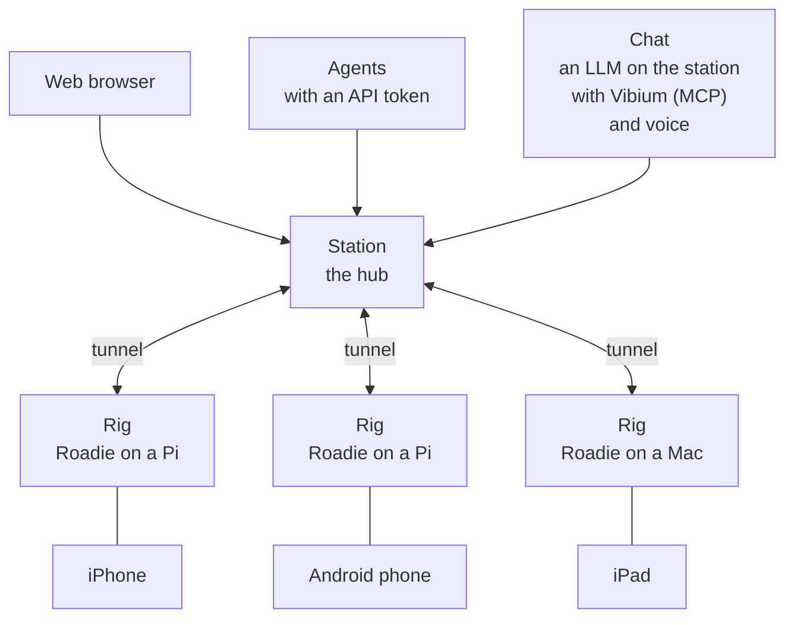

# Vibium Station

Vibium Station lets people and AI agents use real devices from anywhere:
see them, touch them, and talk to them.

Each device sits on a rig: today, a Raspberry Pi running
[Roadie](https://github.com/VibiumDev/roadie) with a phone plugged in. The
rig dials out to the station, so it works from behind any router.

## How it works



- **People** open a device in the browser and drive it.
- **Agents** drive it through the API, with REST and WebDriver BiDi.
- **Chat** runs on the station: you type what you want done, and an LLM
  you set up does it on the device through Vibium's MCP tools, speaking and
  listening with text-to-speech and speech-to-text models. The station's
  pages call each chat a jam session.
- **Video, sound and input** go over WebRTC, directly or through the
  station's TURN relay.
- **Each rig** dials out to the station, which is the hub, and checks a
  grant signed by the station before it takes any input.

## Voice, both ways

A station carries each device's sound in both directions at once (full
duplex), so people and agents can talk to a device and hear it answer. That makes it a place to
test voice assistants, voice agents and any app where sound matters.

- In the viewer, you hear the device and talk to it with your own
  microphone.
- Agents speak and listen with Vibium: `vibium say` speaks into the
  device, and `vibium listen` turns its answer into text, with how long it
  took ([say and listen](https://github.com/VibiumDev/vibium/blob/main/docs/specs/say-listen-spec.md)).
- A chat can talk to the device and check what it says back, with Piper on
  the station or a cloud voice.
- Recordings keep both sides of the sound, and the Record Store plays them.

## What it does

- Sign-in with a password and an authenticator app, or a tailnet identity
- Users and teams: regular users see only the devices their teams were given
- One person or agent in control of a device at a time, and one watching
- Chat: an LLM you set up does what you ask on a device
- Two-way sound, with speech on the station (Piper) or in the cloud
- A Record Store for recordings, screenshots and sound, played in place
- Runs on your LAN, your tailnet, or the public internet

## Get started

No release is published yet, so build it with Go 1.27.4 or newer:

```bash
go build ./cmd/station
./station passwd                              # the owner's password
./station                                     # LAN: https://<your ip>:8443
./station --tailnet --allow you@example.com   # or your tailnet
./station --public station.example.com        # or the internet
```

Then:

1. Make an enrollment code on **Settings → Rigs**.
2. On the rig, run `roadie enroll https://<station> --code <code>`.
3. Open the phone from **Devices**.
4. For chat, add an AI model on **Settings → AI**.

## Docs

| To | Read |
|---|---|
| Run a station on your own server | [Self-host a station](docs/how-to-guides/self-host.md) |
| Run one on Fly.io | [Deploy to Fly.io](docs/how-to-guides/deploy-to-fly.md) |
| Set up chat and voices | [Set Up Jams](docs/how-to-guides/set-up-jams.md) |
| Point an agent at a device | [Reach a device through the station](docs/tutorials/agent-through-the-station.md) |
| Use the API | [API.md](API.md) |
| Look up a command or flag | [Commands and flags](docs/reference/commands-and-flags.md) |
| See how it keeps devices safe | [Security in short](docs/explanation/security.md), [Nostr keys](docs/explanation/nostr-keys.md) |
| Embed it in a service of your own | [Packages](docs/reference/packages.md) |
| Read the design | [Remote spec](docs/remote-spec.md), [teams](docs/specs/teams.md), [jams](docs/specs/jams.md) |

## Status

Milestones R0 to R5 of the [remote spec](docs/remote-spec.md) are done.
Packaging and hardening (R6) and recordings (R7) are in review.
